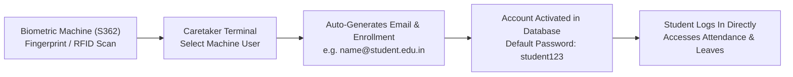

# THDC Hostel Attendance Management System — Credentials & Role Directory

This document provides the complete reference for all verified institutional login credentials, role assignments, biometric student onboarding access workflows, and hostel-to-device mappings.

---

## 1. Master Institutional Credentials Directory

All accounts listed below are active, verified against the database and backend authentication endpoints, and ready for institutional use.

| Role | Designee / Title | Email Address | Password | Assigned Hostel / Domain | Dashboard Route |
| :--- | :--- | :--- | :--- | :--- | :--- |
| **Super Admin** | System Administrator | `admin@university.edu.in` | `admin123` | Campus-wide (All Systems) | `/` (Admin View) |
| **Director** | Dr. S. K. Pradhan (Director) | `director@university.edu.in` | `director123` | Institutional Executive Oversight | `/` (Director Dashboard) |
| **Chief Warden** | Chief Warden | `chiefwarden@university.edu.in` | `chief123` | All Hostels & Disciplinary Control | `/` (Chief Warden Dashboard) |
| **Warden (BH-1)** | Residential Warden (Boys Hostel 1) | `warden.bh1@university.edu.in` | `warden123` | Boys Hostel 1 (BH1 - Shivalik) | `/` (Residential Warden) |
| **Warden (GH)** | Residential Warden (Girls Hostel) | `warden.gh@university.edu.in` | `warden123` | Girls Hostel (GH - Mandakini) | `/` (Residential Warden) |
| **Warden (BH-2)** | Residential Warden (Boys Hostel 2) | `warden.bh2@university.edu.in` | `warden123` | Boys Hostel 2 (BH2 - Nilgiri) | `/` (Residential Warden) |
| **Caretaker / Biometric Operator** | Mr. V. Mehra (Biometric In-Charge) | `vmehra@university.edu.in` | `mehra123` | Biometric Terminal (S362) & Attendance | `/` (Biometric Terminal) |
| **Student (Default Demo)** | Rahul Sharma | `rahul.sharma@student.edu.in` | `student123` | Boys Hostel 1 (Room 101, Bed A) | `/` (Student Portal) |
| **Student (Resident 1)** | Resident Student | `resident1@student.edu.in` | `student123` | Boys Hostel 1 (Room 101) | `/` (Student Portal) |

> [!NOTE]
> Backward-compatible alias emails for wardens (`rw.shivalik@university.edu.in`, `warden.mandakini@university.edu.in`, and `rw.nilgiri@university.edu.in`) also remain functional with password `warden123`.

---

## 2. Hostel Biometric Devices & Terminal Mapping (BH-1, GH, BH-2)

Each hostel has its dedicated biometric hardware terminal mapped in the system:

| Terminal Name | Hardware Serial | Assigned Hostel | Hostel Code | Terminal IP | Status | Mapped Residents |
| :--- | :--- | :--- | :---: | :--- | :--- | :---: |
| **Boys Hostel 1 Terminal** | `RSS20241199684` | Boys Hostel 1 (ID: 1) | `BH1` | `192.168.1.22` | **Online (Live S362)** | 30 Students |
| **Girls Hostel Terminal** | `RSS20241199685` | Girls Hostel (ID: 2) | `GH` | `192.168.1.24` | **Standby / Ready** | 1 Student |
| **Boys Hostel 2 Terminal** | `RSS20241199686` | Boys Hostel 2 (ID: 3) | `BH2` | `192.168.1.25` | **Standby / Ready** | 4 Students |

### Mapping & Punch Routing:
- When a student is enrolled, selecting their hostel (e.g. `Boys Hostel 1`, `Girls Hostel`, `Boys Hostel 2`) automatically binds them to that hostel's biometric terminal.
- Live punch records from MongoDB (`glog_data`) display the specific **Hostel Badge (`BH1`, `GH`, `BH2`)** and **Device Serial Number** for full auditability.

---

## 3. Biometric Device Student Onboarding & Auto-Credentials

When new students are added through the biometric hardware machine (S362) or Caretaker Biometric Terminal:

### Automatic Credentials Generation Rules:
1. **Login Email:** Auto-derived from the enrolled student's name: `<firstname>.<lastname>@student.edu.in` (or `2024BIOxxx@student.edu.in` if name is unassigned).
2. **Default Password:** Set automatically to `student123`.
3. **Account Activation:** Instantly created in `users` with role `Student` and status `active`.
4. **Onboarding Banner:** Upon completing registration in the Caretaker Dashboard, a **Generated Student Login Credentials** banner displays the exact email and password on-screen for immediate student notification.

---

## 4. Role Permissions & Access Control Matrix

| System Capability | Super Admin | Director | Chief Warden | Wardens (BH1, BH2, GH) | Caretaker Operator | Student |
| :--- | :---: | :---: | :---: | :---: | :---: | :---: |
| **Staff Account Creation & Management** |  Allowed | ❌ Restricted | ❌ Restricted | ❌ Restricted | ❌ Restricted | ❌ Restricted |
| **Security Audit Logs** |  Allowed |  Allowed |  Allowed | ❌ Restricted | ❌ Restricted | ❌ Restricted |
| **Campus Attendance & Defaulters Overview** |  Allowed |  Allowed |  Allowed |  (Assigned Hostel) |  View | ❌ Restricted |
| **Hostel Student Directory** |  Allowed |  Allowed |  Allowed |  (Assigned Hostel) |  Allowed | ❌ Restricted |
| **Leave Approval & Sanction** |  Allowed |  Allowed |  Allowed |  (Assigned Hostel) | ❌ Restricted | ❌ Restricted |
| **Biometric Hardware Terminal & Sync** |  Allowed |  Allowed |  Allowed |  Allowed |  Full Access | ❌ Restricted |
| **Personal Student Attendance & Leaves** | ❌ N/A | ❌ N/A | ❌ N/A | ❌ N/A | ❌ N/A |  Own Profile Only |

---

## 5. Verification Test Summary

- **Authentication Endpoints:** All 9 role accounts verified with HTTP 200 and Sanctum token dispatch.
- **Wrong Password Protection:** Invalid passwords correctly rejected with HTTP 422.
- **Hostel Isolation:** Residential Wardens only access records belonging to their assigned hostel (`BH1` = 1, `GH` = 2, `BH2` = 3).
- **All 3 Terminals Verified:** Terminal API `/api/biometric/devices` correctly dispatches details for BH1, GH, and BH2 with live student counts.
